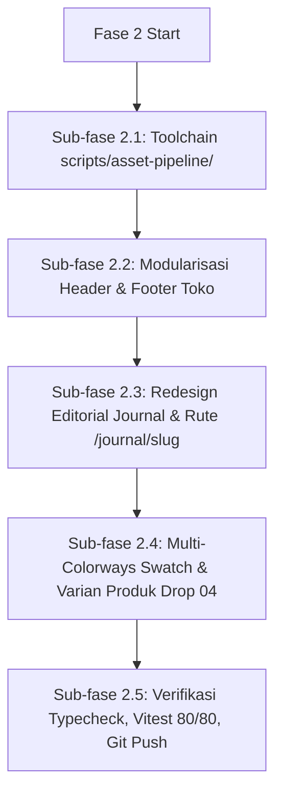

# Advance Plan - Fase 2: Product Multi-Colorways, Asset Pipeline, Layout Modularization & Journal Archive Redesign

> **Proyek**: VOID Supply (E-Commerce Merchandise)  
> **Status**: Disetujui via `/grill-me` Konsensus  
> **Standar Arsitektur**: Next.js 16 App Router, TypeScript Strict, Tailwind CSS v4 Kanonikal, `/javascript-mastery`, Anti-Slop Mode 1 (DURING Tanpa Em Dash)

---

## 1. Tujuan & Ruang Lingkup Fase 2

Berdasarkan evaluasi menyeluruh dan hasil interview `/grill-me`, Fase 2 mencakup 5 pilar utama:

1. **Modular Asset Pipeline (`scripts/asset-pipeline/`)**:
   - Membangun toolchain JavaScript modern berstandar `/javascript-mastery` (ESM, async/await, streaming, retry backoff, sharp WebP compression) untuk download, konversi, mapping, dan pembuatan katalog manifest otomatis.
   - Menghapus ketergantungan pada placeholder SVG generatif buatan tangan.

2. **Dekomposisi & Modularisasi Navbar + Footer Toko**:
   - Memecah `HeaderToko.tsx` dan `FooterToko.tsx` menjadi sub-komponen modular terfokus di `src/components/layout/`.
   - Menambahkan deteksi rute aktif (`usePathname()`), accessible mobile navigation drawer (min tap target 44px, keyboard ESC dismiss, focus trap), dan bar legal kanonikal.

3. **Redesign & Rekonstruksi Editorial Journal (`/journal/[slug]`)**:
   - Menghadirkan halaman index kronologis jurnal dan rute dinamis `/journal/[slug]` untuk seluruh 4 babak perilisan:
     - **Drop 04**: *NIGHT TRANSMISSION* (Aktif)
     - **Drop 03**: *CONCRETE MONOLITH* (Arsip / Vault)
     - **Drop 02**: *NOCTURNAL DYNAMICS* (Arsip / Vault)
     - **Drop 01**: *INITIAL PROTOCOL* (Arsip / Vault)
   - Setiap rute dilengkapi narasi kuratorial filosofis, spesifikasi tekstil mendalam (GSM, weave, finishing dye), palet warna historis berswatch hex, editorial lookbook 16:9, dan arsip artikel rilisan.

4. **Multi-Colorways & Spesifikasi Varian Produk (Drop 04)**:
   - Menambahkan dukungan varian warna multi-colorways (*Washed Black* `#1A1A1A`, *Phantom Charcoal* `#2E3033`, *Raw Olive* `#4A4B3A`, *Bone White* `#E5E2DA`) ke dalam skema relasional `varian_produk` dan UI pemilih warna (*Color Swatch Selector*).
   - Menghubungkan varian warna dengan galeri gambar yang sesuai.

5. **Best Practices Visual Prompting & Standarisasi Aset Anti-Slop**:
   - Membakukan formula prompt studio editorial fotorealistik untuk apparel tanpa efek murahan atau artifak 3D AI slop.
   - Standarisasi ukuran dan rasio (4:5 portrait untuk pakaian, 16:9 untuk lookbook, 1:1 untuk detail tekstur makro).
   - Optimasi `next/image` dengan proper `sizes`, `loading="lazy"` / `priority`, dan atribut `alt` aksesibel WCAG AA.

---

## 2. Struktur Rinci & Tahapan Eksekusi



### Sub-Fase 2.1: Toolchain Modular Asset Pipeline (`scripts/asset-pipeline/`)
- [ ] `scripts/asset-pipeline/types.d.ts`: Definisi interface JSDoc & TypeScript untuk metadata aset, status download, konfigurasi sharp, dan manifest.
- [ ] `scripts/asset-pipeline/downloader.mjs`: Utility download stream dengan `fetch`, abort controller timeout 10 detik, exponential backoff (3 kali retry), dan MIME type validation.
- [ ] `scripts/asset-pipeline/converter.mjs`: Pemroses gambar sharp terstandarisasi untuk WebP 4:5 (800x1000), 16:9 (1920x1080), dan 1:1 (1000x1000) dengan preset kualitas seimbang (quality 85..90, effort 6).
- [ ] `scripts/asset-pipeline/mapper.mjs`: Pemetik dan pemindah aset terotomatisasi ke direktori `public/assets/products/`, `public/assets/lookbook/`, dan `public/assets/brand/`.
- [ ] `scripts/asset-pipeline/manifest.mjs`: Generator JSON manifest ringkas untuk validasi integritas aset di runtime.
- [ ] Pembersihan script lama yang memuat generator SVG buatan tangan (`scripts/generate-assets.js`).

### Sub-Fase 2.2: Modularisasi Layouting Navbar & Footer Toko
- [ ] Dekomposisi Header Toko di `src/components/layout/header/`:
  - `HeaderToko.tsx`: Orchestrator ramping dengan sticky header dan backdrop blur.
  - `NavLinks.tsx`: Navigasi desktop dengan highlighting rute aktif (`usePathname()`).
  - `LanguageSelector.tsx`: Sakelar bahasa ID/EN terisolasi dengan tap target 36px (`min-h-9`).
  - `CartButton.tsx`: Tombol tas belanja dengan animasi badge counter dan label aria deskriptif.
  - `MobileNavDrawer.tsx`: Drawer seluler layar penuh dengan tap target minimal 44px (`min-h-11`), tombol tutup ESC, dan trap fokus.
- [ ] Dekomposisi Footer Toko di `src/components/layout/footer/`:
  - `FooterToko.tsx`: Orchestrator grid responsive 5 kolom.
  - `FooterBrand.tsx`: Identitas merek, emblem logo WebP, filosofi studio, dan tautan sosial media.
  - `FooterQuickLinks.tsx`: Navigasi etalase, editorial journal, material, tentang, kontak, dan pelacakan kurir.
  - `FooterPaymentPartners.tsx`: Barisan logo WebP resmi bank dan kurir berlisensi resmi.
  - `FooterLegalBar.tsx`: Baris bawah hak cipta tanpa em dash, tautan kebijakan privasi, syarat ketentuan, dan kebijakan pengembalian.

### Sub-Fase 2.3: Redesign Editorial Journal & Rute Dinamis `/journal/[slug]`
- [ ] `src/features/journal/data/journal-archive.ts`: Sumber data kuratorial terstruktur untuk 4 babak perilisan:
  - Drop 04 (*Night Transmission* - Oktober 2026 - Aktif)
  - Drop 03 (*Concrete Monolith* - Juni 2026 - Arsip)
  - Drop 02 (*Nocturnal Dynamics* - Januari 2026 - Arsip)
  - Drop 01 (*Initial Protocol* - Agustus 2025 - Arsip)
  Setiap babak memuat: judul, ringkasan filosofis, esai kuratorial, spesifikasi material (tipe rajutan, berat kain GSM, teknik celup, konstruksi jahitan), palet warna historis dengan kode hex dan nama pigmen, galeri gambar editorial (lookbook 16:9 + detail 4:5), serta daftar SKU artikel bersejarah.
- [ ] `src/app/journal/page.tsx`: Halaman index editorial yang dirancang ulang dengan visual hero dramatis, filter kronologis, dan kartu arsip interaktif menuju rute detail.
- [ ] `src/app/journal/[slug]/page.tsx`: Halaman Server Component dinamis dengan generateStaticParams(), metadata OpenGraph SEO lengkap, tata letak editorial editorial majalah streetwear, spesifikasi kain, dan lookbook viewer.

### Sub-Fase 2.4: Multi-Colorways Swatch & Varian Produk Drop 04
- [ ] Perluasan skema atau penambahan utilitas pemilih swatch warna di komponen kartu produk dan halaman detail produk (`src/features/catalog/components/ColorSwatchSelector.tsx`).
- [ ] Palet warna resmi Drop 04:
  - **Jet Black**: `#0A0A0A`
  - **Washed Black**: `#1A1A1A`
  - **Phantom Charcoal**: `#2E3033`
  - **Raw Olive**: `#4A4B3A`
  - **Bone White**: `#E5E2DA`
- [ ] Pembaruan `seed.ts` dan repository katalog untuk mendukung mapping swatch warna riil dan galeri varian.

### Sub-Fase 2.5: Verifikasi Kualitas, Zero-Warning & Git Push
- [ ] `npx tsc --noEmit` : 0 error strict type safety.
- [ ] `npm test` : 80/80 unit tests Vitest wajib lulus.
- [ ] Validasi anti-slop: tidak ada karakter em dash (`—`) pada seluruh teks UI maupun komentar.
- [ ] Git commit dan push ke remote `origin/main`.

---

## 3. Standar Prompting Visual Generatif (Anti-Slop Fashion Photography)

Untuk memastikan hasil generasi gambar apparel memiliki mutu tinggi yang menyerupai pemotretan studio editorial nyata (bukan ilustrasi 3D render atau gambar kartun):

```text
Editorial high-fashion streetwear photography of [APPAREL ITEM] in [COLORWAY], shot on Hasselblad H6D-100c medium format camera with 80mm f/2.8 lens. Natural diffused key light from 45-degree angle, authentic soft studio shadows, subtle 35mm fine film grain texture. Heavyweight textured cotton weave visible, authentic garment drape and subtle natural fabric folds, precision double chainstitch seams and reinforced collar ribbing. Clean architectural brutalist raw concrete studio backdrop, minimalist composition, matte dark aesthetic, luxury high-street presentation. Authentic garment photography, no plastic shine, no unrealistic 3D CGI gloss, no deformed textiles.
```

---

## 4. Jadwal Rilis & Komitmen

- Setiap sub-fase akan diverifikasi kelayakannya sebelum berpindah ke langkah selanjutnya.
- Kode dan aset yang telah selesai diuji akan langsung di-commit dengan pesan konvensi semantik dan di-push ke branch `main`.
