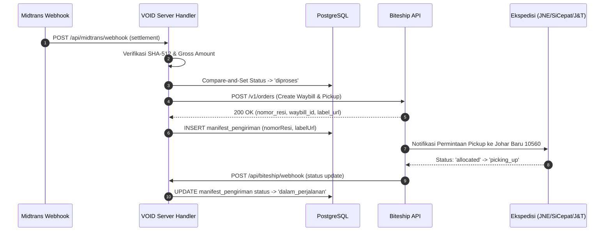

# Arsitektur Rekayasa: Module 03 Commerce Operations & Growth

> **Status**: Dokumen Riset & Desain Arsitektural Resmi  
> **Target Implementasi**: Pasca Kelulusan Module 02.17 Production Readiness Gate  
> **Konvensi Bahasa**: Bahasa Indonesia untuk Domain Bisnis & Dokumentasi Teknis  

---

## 1. Domain Modeling: Operasional Inventaris & Logistik

Untuk mendukung operasional skala komersial penuh, skema Drizzle ORM PostgreSQL akan diekspansi dengan entitas baru yang melengkapi tabel `pesanan`, `item_pesanan`, dan `varian_produk`:

```typescript
// Konseptual Schema Drizzle Module 03

// 1. Lokasi Gudang / Fulfillment Center
export const gudang = pgTable("gudang", {
  id: uuid("id").defaultRandom().primaryKey(),
  kode: varchar("kode", { length: 20 }).notNull().unique(), // Contoh: 'JKT-JOHAR-01'
  nama: varchar("nama", { length: 100 }).notNull(),
  alamatLengkap: text("alamat_lengkap").notNull(),
  kodePos: varchar("kode_pos", { length: 10 }).notNull(),
  apakahAktif: boolean("apakah_aktif").default(true).notNull(),
  dibuatPada: timestamp("dibuat_pada").defaultNow().notNull(),
});

// 2. Alokasi Stok per Gudang
export const stokGudang = pgTable("stok_gudang", {
  id: uuid("id").defaultRandom().primaryKey(),
  gudangId: uuid("gudang_id").references(() => gudang.id).notNull(),
  varianId: uuid("varian_id").references(() => varianProduk.id).notNull(),
  kuantitasFisik: integer("kuantitas_fisik").default(0).notNull(),
  kuantitasTeralokasi: integer("kuantitas_teralokasi").default(0).notNull(), // Sedang diproses / reserved
  batasPeringatanMenipis: integer("batas_peringatan_menipis").default(5).notNull(),
  diperbaruiPada: timestamp("diperbarui_pada").defaultNow().notNull(),
});

// 3. Manifest Pengiriman & AWB Tracking
export const manifestPengiriman = pgTable("manifest_pengiriman", {
  id: uuid("id").defaultRandom().primaryKey(),
  pesananId: uuid("pesanan_id").references(() => pesanan.id).notNull().unique(),
  kurir: varchar("kurir", { length: 50 }).notNull(),
  nomorResi: varchar("nomor_resi", { length: 100 }),
  biteshipOrderId: varchar("biteship_order_id", { length: 100 }),
  statusPengiriman: varchar("status_pengiriman", { length: 50 }).default("menunggu_penjemputan").notNull(),
  labelPengirimanUrl: text("label_pengiriman_url"),
  waktuPenjemputan: timestamp("waktu_penjemputan"),
  waktuTerkirim: timestamp("waktu_terkirim"),
  dibuatPada: timestamp("dibuat_pada").defaultNow().notNull(),
  diperbaruiPada: timestamp("diperbarui_pada").defaultNow().notNull(),
});
```

---

## 2. Automated Fulfillment Pipeline (Zero-Manual AWB)

Alur otomatisasi ketika notifikasi `settlement` diterima dari gateway pembayaran Midtrans:



### Prinsip Keamanan & Ketahanan Fulfillment:
1. **Idempotent AWB Generation**: Pemanggilan `create_order` ke Biteship menggunakan `order_id` pesanan sebagai parameter request idempotent untuk mencegah pembuatan resi ganda jika webhook Midtrans terkirim berulang.
2. **Kompensasi Kegagalan Logistik**: Apabila pembuatan waybill Biteship mengalami kegagalan (misalnya API pihak ketiga timeout), status pesanan tetap `diproses`, dan sistem mencatat notifikasi insiden ke log observabilitas untuk retry otomatis via scheduled job.

---

## 3. Customer Portal & Passwordless Magic Authentication

Untuk menjaga integritas brand technical brutalist dan keamanan data pembeli:

1. **Magic Link / Time-Based OTP via Email**:
   - Menghindari risiko kebocoran password akibat _credential stuffing_.
   - Token berentropi tinggi 128-bit disimpan dalam bentuk hash SHA-256 di basis data dengan waktu kedaluwarsa 10 menit.
2. **Dashboard Pesanan Terpadu**:
   - Riwayat seluruh pesanan yang terasosiasi dengan alamat email pelanggan.
   - Status live tracking resi pengiriman real-time dari kurir.
   - Akses eksklusif rilisan drop prioritas.

---

## 4. Commerce Analytics & Conversion Funnel Engine

Model analitika fungsional tanpa membebani runtime komputasi produksi:

| Metrik | Deskripsi | Target Benchmark |
| :--- | :--- | :--- |
| **Catalog View to PDP** | Rasio pengunjung katalog yang membuka halaman rincian produk | > 45% |
| **PDP to Add to Bag** | Rasio pertimbangan pembelian menjadi item di keranjang | > 18% |
| **Checkout Completion** | Rasio checkout dimulai hingga status transaksi `settlement` | > 65% |
| **Cart Abandonment Rate** | Keranjang dengan item yang tidak dilanjutkan ke pembayaran | < 35% |
| **Average Order Value (AOV)** | Rata-rata nilai transaksi rupiah per pesanan berhasil | Rp 850.000+ |

---

## 5. Ringkasan Kesiapan Transisi

Dengan telah tuntasnya **Module 02.17 Production Readiness Gate** (verifikasi contract test webhook Midtrans, perlindungan SEC-05 session cookie, validasi startup environment Zod, sitemap, dan aset visual brutalist monokromatik), repositori VOID Supply telah memiliki pondasi solid untuk memulai eksekusi Submodule 03.1.
