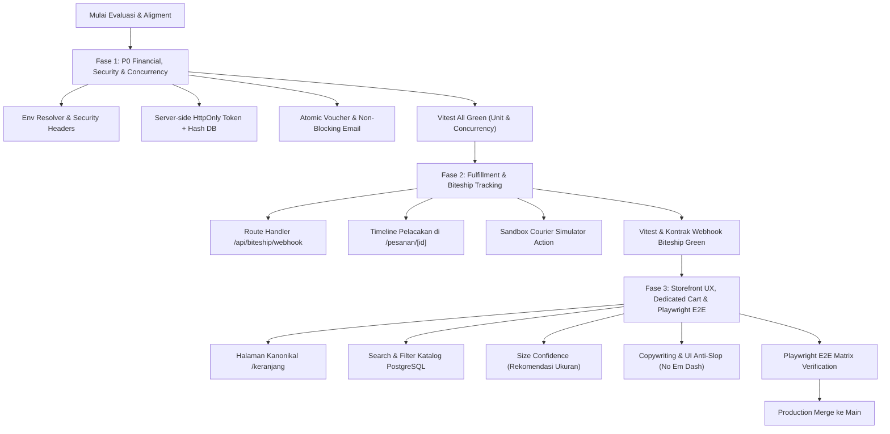

# VOID Supply: E-Commerce Readiness & Production Hardening Plan

Dokumen ini adalah rencana kerja teknis resmi untuk mentransformasikan repositori **VOID Supply** dari fondasi MVP transaksi menjadi toko online busana siap produksi (*production-grade direct-to-consumer e-commerce*), disesuaikan dengan arsitektur **Vercel Hobby Plan**, **Sentry Free Tier**, **PostgreSQL 18**, dan aturan **Anti-Slop (Mode 1: DURING)**.

---

## 1. Hasil Audit Arsitektur & Temuan Kritis (Actual State vs Review)

| Komponen | Status Saat Ini | Dampak Risiko | Tindakan Remediasi Resmi | Status Audit |
| :--- | :--- | :--- | :--- | :--- |
| **Order Access Token** | Terintegrasi HttpOnly cookie & parameter URL aman | Mencegah pembajakan data sensitif pelanggan (IDOR/XSS). | Otorisasi terpusat via `tokenAkses` di seluruh mutasi, invoice, status, dan label thermal. | **Verified / Fixed** |
| **Environment Resolver** | Modul `src/lib/environment/` aktif | Mencegah salah sasaran kredensial sandbox dan live. | Validasi skema Zod `APP_ENV`, Midtrans, Biteship, Resend secara deterministik. | **Verified / Fixed** |
| **Voucher Quota Guard** | Kueri atomik bersyarat di `buat-pesanan.action.ts` | Mencegah overselling kuota voucher saat concurrent flash sale. | Compare-and-Set atomik `WHERE total_digunakan < kuota_penggunaan`. | **Verified / Fixed** |
| **Webhook DB Transaction** | Transactional Outbox + Non-blocking job processing | Menghilangkan penahanan row lock akibat panggilan jaringan lambat. | Pindahkan pengiriman email dan pembuatan arsip faktur ke outbox idempoten. | **Verified / Fixed** |
| **Fulfillment & Tracking** | Route handler `/api/biteship/webhook` & Timeline aktif | Pelacakan kurir terupdate secara otomatis tanpa delay. | Parsing status Biteship terhubung ke tabel `pelacakan_pengiriman` atomik. | **Verified / Fixed** |
| **Vercel Hobby Limits** | Lazy check pada rute pesanan + GitHub Actions staging cron | Menjamin kepatuhan limit kuota cron Vercel Hobby. | Sinkronisasi pasif pesanan saat dibuka + scheduler GitHub Actions 15 menit. | **Verified / Fixed** |
| **Concurrency Tests** | Suite pengujian Vitest `concurrency.test.ts` terisolasi | Memastikan pencegahan overselling 100% tervalidasi. | SKU uji mandiri tanpa kontensi varian lain di database. | **Verified / Fixed** |
| **Virtual Account Gateway** | Nomor VA sintetis dihapus dari `InAppPaymentViewer` | Menghilangkan instruksi transfer palsu yang menyesatkan pelanggan. | Hanya menampilkan nomor VA resmi Midtrans atau tombol pembuka Snap dialog. | **Verified / Fixed (Phase 1A)** |
| **Arsip Faktur & Pajak** | Identitas penerbit VOID SUPPLY STUDIO, PPN 0% (Non-PKP) | Mencegah klaim legal dan perpajakan fiktif tanpa entitas PT/NPWP. | Perhitungan pajak jujur dan pencatatan snapshot faktur via transactional outbox. | **Verified / Fixed (Phase 1A)** |
| **Form Kontak Toko** | Terhubung ke basis data riil via tabel `pesan_kontak` | Menghilangkan false success 800ms tanpa backend riil. | Server Action `kirimPesanKontakAction` dengan Zod validation & audit timestamp. | **Verified / Fixed (Phase 1A)** |
| **State Machine Pesanan** | Guard transisi status `dikirim -> selesai` dengan bukti resi | Mencegah penyelesaian pesanan palsu sebelum paket dikirimkan kurir. | Validasi ketat nomor resi dan pelarangan mutasi dari status `diproses` ke `selesai`. | **Verified / Fixed (Phase 1A)** |
| **Polling Status Pesanan** | Recursive timeout dengan backoff bertahap (3s, 5s, 10s) | Mencegah request overlap, race condition, dan beban server berlebih. | Penguncian in-flight request, AbortController, dan pembatalan segera pasca-bayar. | **Verified / Fixed (Phase 1A)** |

---

## 2. Struktur Tiga Fase Pengerjaan (Phase-Gated Rollout)

---

## 3. Rincian Pekerjaan Tiap Fase

### Fase 1: P0 Financial Integrity & Security Hardening
1. **Perbaikan Concurrency Test (`concurrency.test.ts`)**:
   - Modifikasi setup test agar membuat varian uji sementara dengan SKU unik atau kunci terisolasi, sehingga tidak berbenturan dengan pengujian paralel lainnya di Vitest.
2. **Environment Resolver Terpusat (`src/lib/environment/`)**:
   - Buat `schema.ts` (Zod) dan `resolver.ts` untuk memetakan kredensial Midtrans, Biteship, Resend, dan Database berdasarkan `APP_ENV` (`development`, `staging`, `production`).
   - Hapus pembacaan `process.env` ad-hoc di `midtrans.service.ts` dan `biteship.service.ts`.
3. **Server-Side HttpOnly Order Session Token**:
   - Perbarui Server Action `buatPesanan` untuk menetapkan HttpOnly cookie `void_order_session` via `next/headers` `cookies().set()`.
   - Simpan hash SHA-256 dari token di kolom `hash_token_akses` pada tabel `pesanan`.
   - Hapus penetapan token lewat `document.cookie` di `useCheckout.ts`.
4. **Atomic Voucher Guard**:
   - Ubah mutasi diskon pada `buat-pesanan.action.ts` menjadi kueri bersyarat atomik `WHERE total_digunakan < kuota_penggunaan`.
   - Batalkan transaksi jika tidak ada baris yang terpengaruh (kuota terlampaui saat checkout paralel).
5. **Pemisahan Panggilan Email dari Transaksi Database**:
   - Di `src/app/api/midtrans/webhook/route.ts`, pindahkan `kirimEmailNotifikasi` ke luar blok `db.transaction(...)`.
   - Rekam entri notifikasi ke tabel log/outbox di dalam transaksi, lalu eksekusi pengiriman jaringan secara non-blocking di luar transaksi dengan proteksi try/catch.
6. **Security Headers & Safe JSON-LD**:
   - Pasang header keamanan di `next.config.ts`: CSP, HSTS, `X-Content-Type-Options: nosniff`, `X-Frame-Options: DENY`, `Referrer-Policy`.
   - Sanitasi keluaran JSON-LD pada komponen katalog/produk agar meng-escape karakter `<` menjadi `\u003c`.
7. **Penyelarasan Scheduler Vercel Hobby & Lazy Expiry**:
   - Implementasikan pengecekan pasif (*lazy expiry check*) di Server Action `ambilStatusPesanan` dan rute `/pesanan/[nomorPesanan]`.
   - Perbaiki dokumen `GEMINI.md` dan `.github/workflows/staging-cron.yml` untuk menjelaskan bahwa scheduler 15-menitan dioperasikan oleh GitHub Actions, bukan Vercel Cron.

---

### Fase 2: Fulfillment, Biteship Tracking Webhook & Resi Timeline
1. **Route Handler Webhook Biteship (`src/app/api/biteship/webhook/route.ts`)**:
   - Validasi header autentikasi / signature Biteship.
   - Parsing event status (`order.status_updated`, waybill event).
   - Simpan riwayat titik peristiwa kurir ke tabel `pelacakan_pengiriman` secara atomik.
   - Mutasikan status pesanan secara otomatis:
     - Event `dropping_off` / `picking_up` -> status `dikirim`.
     - Event `delivered` -> status `selesai`.
2. **Komponen Timeline Pelacakan Resi (`src/features/order/components/TimelinePengiriman.tsx`)**:
   - Desain brutalist utilitarian: badge status kurir, nomor resi dengan tombol salin, dan timeline titik checkpoint kurir (waktu, lokasi, keterangan).
   - Terapkan status *loading*, *empty*, dan *error state* sesuai aturan Anti-Slop (R-27).
3. **Simulasi Resi Sandbox untuk Vercel Demo**:
   - Buat Server Action `simulasiPergerakanKurirAction` khusus mode sandbox/development untuk menguji transisi resi (Diproses -> Diserahkan ke Kurir -> Dalam Perjalanan -> Terkirim).

---

### Fase 3: Dedicated Cart, Search/Filter, Size Confidence & Playwright E2E
1. **Halaman Kanonikal Keranjang Belanja (`src/app/(toko)/keranjang/page.tsx`)**:
   - Halaman khusus `/keranjang` lengkap dengan tabel artikel, thumbnail WebP, pemilih jumlah, berat kalkulasi, input voucher promo, dan tombol "Lanjut ke Pembayaran".
   - Sinkronisasi instan dengan Zustand store `useKeranjangStore` dan pencegahan hidrasi desinkronisasi.
2. **Search & Filter Katalog Berbasis PostgreSQL**:
   - Tambahkan input pencarian teks langsung (judul artikel, deskripsi) di `/katalog`.
   - Filter dropdown/tombol: Kategori garmen, ketersediaan stok, rentang harga, dan sorting (harga terendah/tertinggi, drop rilis terbaru).
3. **Fitur Size Confidence (Rekomendasi Ukuran Berbasis Postur)**:
   - Tambahkan modal/drawer interaktif pada halaman produk: input tinggi badan (cm) dan berat badan (kg) serta preferensi fitting (Regular / Boxy / Oversized).
   - Algoritma deterministik mencocokkan dimensi garmen di database (`panduanUkuran`) dan memberikan saran ukuran rekomendasi yang percaya diri.
4. **Pembersihan Copywriting & UI Anti-Slop**:
   - Hapus semua karakter em dash (`—`). Ganti dengan tanda titik, koma, titik dua, atau kurung.
   - Hapus jargon engineering internal seperti "mutasi inventaris", "transaksi terverifikasi", "kanonikal". Ganti dengan copy commerce yang jernih, actionable, dan jujur.
   - Terapkan kontras warna WCAG AA, tap target minimal 44px (`min-h-11`), dan zero IDE warnings Tailwind v4.
5. **Verifikasi E2E Playwright dengan Browser MCP**:
   - Tulis dan jalankan skenario Playwright menyeluruh:
     - Browsing katalog -> Filter artikel.
     - Membuka halaman detail -> Cek rekomendasi ukuran.
     - Tambah artikel ke keranjang -> Periksa `/keranjang`.
     - Checkout dengan data pembeli -> Dapatkan pesanan dan token sesi HttpOnly.
     - Simulasi webhook pembayaran Midtrans -> Periksa faktur dan timeline pengiriman.

---

## 4. Standar Mutu, Penamaan & Kebijakan Anti-Slop

- **Konvensi Bahasa Indonesia**: Seluruh fungsi domain, Server Actions, dan tabel basis data tetap menggunakan Bahasa Indonesia murni (`buatPesanan`, `ambilStatusPesanan`, `hitungOngkir`, `pelanggan`, `pesanan`, `pembayaran`, `pengiriman`, `varianProduk`).
- **Strict Anti-Slop**:
  - Dilarang membuat fake review, fake sold counter, atau fake testimonials.
  - Dilarang menambahkan komentar dekoratif pada kode (`// ======`, emoji).
  - Terapkan prinsip *Fix Terkecil yang Aman*.
- **Vercel Hobby & Sentry Free Tier Optimization**:
  - Payload fungsi serverless dijaga tetap ramping.
  - Sentry diatur dengan `tracesSampleRate: 0.1` pada production demo agar tidak menghabiskan kuota transaksi bulanan gratis.
