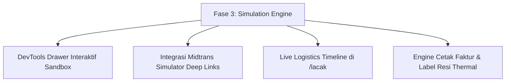

# Rencana Kerja Terpadu: Fase 2.5 (Asset Enrichment) & Fase 3 (Simulation Engine)

> **Proyek**: VOID Supply (E-Commerce Merchandise)  
> **Status**: Disetujui via `/grill-me` Konsensus  
> **Prinsip**: Anti-Slop Mode 1 (DURING Tanpa Karakter Em Dash), `/javascript-mastery`, Strict Type Safety

---

## 1. Rencana Aksi Fase 2.5: Pengayaan Aset Visual & Media Website

Fase 2.5 difokuskan sepenuhnya pada pengadaan, generasi fotorealistik via model Gemini Imagen berstandar studio editorial, dan konversi Sharp WebP terstandarisasi untuk 4 paket aset utama:

### Paket 1: Foto Varian Multi-Colorways (Drop 04)
Pengadaan aset foto 4:5 portrait (800x1000px) untuk seluruh colorway baru yang telah terdaftar di sistem katalog:
- **T-Shirt 01 Heavyweight Boxy Tee**:
  - `void-tee-heavyweight-front-washed-black.webp` & `void-tee-heavyweight-back-washed-black.webp`
  - `void-tee-heavyweight-front-phantom-charcoal.webp` & `void-tee-heavyweight-back-phantom-charcoal.webp`
  - `void-tee-heavyweight-front-raw-olive.webp` & `void-tee-heavyweight-back-raw-olive.webp`
- **Vintage Acid Wash Tee 02**:
  - `void-tee-acidwash-front-phantom-charcoal.webp` & `void-tee-acidwash-back-phantom-charcoal.webp`
  - `void-tee-acidwash-front-raw-olive.webp` & `void-tee-acidwash-back-raw-olive.webp`
- **Night Transmission Heavy Zip Hoodie**:
  - `void-hoodie-zip-front-washed-black.webp` & `void-hoodie-zip-back-washed-black.webp`
  - `void-hoodie-zip-front-raw-olive.webp` & `void-hoodie-zip-back-raw-olive.webp`

### Paket 2: Foto Kampanye Editorial Lookbook 16:9 (Arsip Drop 01, 02, 03)
Pengadaan foto banner beresolusi tinggi 1920x1080px untuk menggantikan placeholder lookbook umum pada rute dinamis `/journal/[slug]`:
- `public/assets/lookbook/drop-03-concrete-monolith-lookbook.webp`:
  Fotografi brutalist berlatar belakang struktur beton monumental di bawah langit kelabu, menampilkan model mengenakan tubular seamless hoodie 500 GSM.
- `public/assets/lookbook/drop-02-nocturnal-dynamics-lookbook.webp`:
  Fotografi malam jalanan metropolitan dengan pencahayaan lampu merkuri jalan raya dan refleksi aspal basah, menampilkan model mengenakan longsleeve termal dan transit cargo.
- `public/assets/lookbook/drop-01-initial-protocol-lookbook.webp`:
  Fotografi studio minimalis monokromatik berlatar kanvas katun mentah tidak terkelantang (unbleached canvas), merayakan prototipe jahitan jarum tunggal 16s.

### Paket 3: Makro Tekstur Serat Kain & Hardware Garmen (1000x1000px, 1:1)
- `public/assets/products/drop-04/macro-cotton-16s-weave.webp`: Tekstur rajutan benang combed 16s tebal.
- `public/assets/products/drop-04/macro-french-terry-500gsm.webp`: Lingkaran rajutan dalam loopback 500 GSM.
- `public/assets/products/drop-04/macro-ykk-matte-zipper.webp`: Detail slider dan gigi ritsleting YKK kustom warna hitam doff.

### Paket 4: OpenGraph Meta Previews & Social Media Cards
- `public/assets/brand/og-void-catalog-2026.webp` (1200x630px): Banner pratinjau tautan resmi untuk WhatsApp, X (Twitter), dan iMessage.
- Pembaruan manifest katalog via `node scripts/asset-pipeline/index.mjs --manifest`.

---

## 2. Rencana Aksi Fase 3: Transaction & Logistics Simulation Engine

Fase 3 berfokus pada pengalaman simulasi end-to-end yang realistis, aman, dan dapat diuji langsung oleh reviewer portofolio:

### 1. DevTools Sandbox Drawer Interaktif (`src/features/checkout/components/DevToolsDrawer.tsx`)
- Komponen *floating drawer* di sudut kanan bawah yang hanya aktif jika `ALLOW_PAYMENT_MOCK=true` atau `NEXT_PUBLIC_DEMO_MODE=true` (aman 100% dari kebocoran ke *production*).
- Tombol shortcut satu klik untuk:
  - Pelunasan pesanan instan (memicu Server Action `simulasiPembayaranBerhasil`).
  - Pembatalan/kedaluwarsa instan (memicu Server Action kompensasi pengembalian stok atomik).
  - Simulasi pembaruan kurir Biteship (*allocated*, *picking_up*, *delivered*).

### 2. Deep Linking Midtrans Sandbox Simulator
- Pembuatan tautan instan ke `https://simulator.sandbox.midtrans.com/` dengan parameter nomor Virtual Account (BCA, Mandiri, BNI, BRI) atau kode transaksi QRIS yang telah diisi otomatis dari pesanan aktif.
- Panduan instruksi interaktif bagi penguji untuk menyalin nomor VA dan mengklik tombol "Bayar" di simulator Midtrans.

### 3. Timeline Pelacakan Kurir Real-Time di Rute Kanonikal `/lacak`
- Menampilkan visualisasi pelacakan paket tahap demi tahap:
  - Pesanan Dibuat -> Pembayaran Terverifikasi -> Paket Dikemas di Gudang Johar Baru -> Kurir Menjemput Paket -> Dalam Perjalanan Menuju Alamat Tujuan -> Paket Diterima.
- Integrasi riwayat logistik riil dari Biteship Logistics API webhook payload.

### 4. Cetak Dokumen Legal Komersial (Faktur PDF & Resi Thermal)
- Halaman cetak faktur komersial resmi di `/faktur/[nomorPesanan]` dengan verifikasi token akses IDOR SEC-02.
- Halaman cetak label resi thermal ukuran standar 100x150 mm di `/resi/[nomorPesanan]` yang siap dicetak ke printer thermal (Direct Thermal 203 DPI) dengan barcode Code128 kanonikal.
